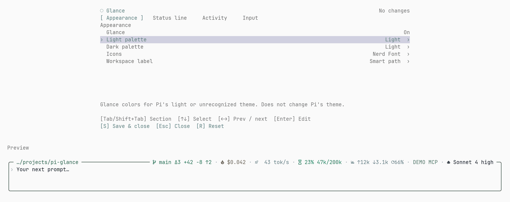

<div align="center">

# ◌ pi-glance-tps

**A rounded editor and status line for [Pi](https://github.com/earendil-works/pi), with live tokens/s.**

English · [简体中文](./README.zh-CN.md)

[](LICENSE)

Forked from [pi-glance](https://github.com/LinYS77/pi-glance). The live speed display is merged into the status line, so the separate tokens-per-second extension is no longer needed.

</div>

<p align="center">
  
</p>

## Install

From a local checkout (not published to npm):

```bash
pi install ./pi-glance-tps
```

Restart Pi or run `/reload`.

## Features

- **Rounded editor** — Pi's editing, history, autocomplete and keybindings stay unchanged.
- **Adaptive status line** — Git · Cost · Live speed · Context · Tokens · Extensions · Model. Model is the last item hidden.
- **Prompt stash** — `alt+s` puts input aside; press again to restore or swap.
- **Activity** — bottom-border text, or sweeps for work/summaries and blinking for retries. Adjust speed, color, summary multiplier and blink rate.
- **22 palettes** — light and dark choices with live preview.

No runtime dependencies. No telemetry.

### Live output speed

While the assistant streams, the status line shows the smoothed rate (`⠇ 168.8 t/s`); when the message ends it shows that message's generation-window average (`✓ 168.8 t/s`). The live rate comes from streamed content deltas (≈4 characters per token) over ≥250 ms windows with an EMA, because most providers report final usage only in their last chunk. The clock starts with the first content, so prefill wait time stays out of the rate.

Colour bands: normal at 100 t/s and above, warning from 30, error below 30. Token counts, the thinking breakdown and elapsed time are not shown in this segment.

Without a live sample the segment falls back to the request-level average inherited from pi-glance: provider output divided by observed request durations, excluding tool execution, inter-request gaps and blocking UI prompts.

## Configure

Run `/glance-tps` for **Appearance**, **Status line**, **Activity**, and **Input** settings. `Tab` switches sections, arrows adjust, and `S` saves.

The full-width preview sits below settings. Closing preserves input and cursor.

<p align="center">
  
</p>

<p align="center">
  
</p>

Previews use example data.

## Notes

- Nerd Font icons are enabled by default. For regular fonts, select `Plain` in `/glance-tps` → **Appearance** → **Icons**.
- Activity defaults to **Text**. Choose **Sweep** under **Activity** for border effects.
- Git **Summary** shows changed files and tracked `+ / −` lines. Local polling slows from 5 to 30 seconds while unchanged; activity brings refreshes forward. External edits are picked up by polling. **Auto fetch** checks upstream every 5 minutes; disable under **Status line → Git**.
- Drafts persist per session until restored. `--no-session` keeps them in memory.
- **Extensions** shows compatible plugins' status text. Toggle, reorder or inspect under **Status line**; empty groups stay hidden.
- Other editor or footer extensions may override parts of GlanceTps's display.
- Requires Pi 1.0.0+ and Node.js 22.19.0 or newer.

## Update

```bash
cd <checkout>
git pull
```

## Contributing

Issues and pull requests are welcome. Development notes: [CONTEXT.md](./CONTEXT.md).

## License

[MIT](LICENSE) © 2026 linys77 — fork of [pi-glance](https://github.com/LinYS77/pi-glance).
