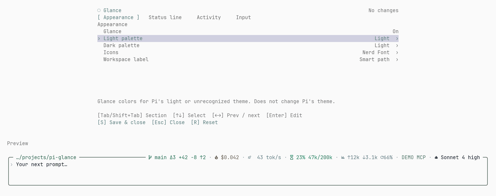

<div align="center">

# ◌ pi-glance-tps

**[Pi](https://github.com/earendil-works/pi) 的圆角编辑器与状态栏，内置实时 tokens/s。**

[English](./README.md) · 简体中文

[](LICENSE)

Fork 自 [pi-glance](https://github.com/LinYS77/pi-glance)。实时速度显示已并入状态栏，不再需要单独的速度插件。

</div>

<p align="center">
  
</p>

## 安装

从 GitHub 安装（尚未发布到 npm）：

```bash
pi install git:github.com/jixule/pi-glance-tps
```

需要固定版本时加 `@v0.1.0`。重启 Pi，或执行 `/reload`。

## 功能

- **圆角编辑器** — 保留 Pi 原有的编辑、历史、自动补全和快捷键。
- **自适应状态栏** — Git · 费用 · 实时速度 · 上下文 · Tokens · 扩展状态 · 模型。空间不足时，模型最后隐藏。
- **输入暂存** — `alt+s` 暂存提示词，再按恢复；输入框已有新内容时，两份内容交换。
- **Activity 状态** — 默认使用下边框文字；也可选择工作扫光、压缩／摘要倍率扫光和重试闪烁，调整速度、配色、倍率及闪烁频率。
- **22 套配色** — 分别选择亮色与暗色方案，实时预览。

无额外运行时依赖，不收集遥测数据。

### 实时输出速度

生成过程中状态栏显示平滑后的实时速率（`⠇ 168.8 t/s`），消息结束时显示本条消息的生成窗口平均值（`✓ 168.8 t/s`）。实时速率来自流式内容的字符增量（约 4 字符/token），以 ≥250ms 为采样窗口并做 EMA 平滑——多数供应商只在最后一个分片上报精确 usage。计时从第一枚内容开始，因此首包/预填充等待不计入速率。

颜色分档：≥100 t/s 正常，30–99 警告，低于 30 错误。该段不显示 tokens 数量、思考明细和耗时。

没有实时数据时，回退到继承自 pi-glance 的请求级平均值：供应商输出除以观测到的请求耗时，排除工具执行、请求间等待和阻塞式 UI 提示。

## 设置

运行 `/glance-tps`，设置 **Appearance（外观）**、**Status line（状态栏）**、**Activity（活动状态）** 和 **Input（输入）**。`Tab` 切换分区，方向键调整，`S` 保存。

预览在设置下方按完整输入区宽度显示；关闭面板后保留输入内容和光标位置。

<p align="center">
  
</p>

<p align="center">
  
</p>

预览图使用示例数据。

## 说明

- 默认使用 Nerd Font 图标。使用普通字体时，可在 `/glance-tps` → **Appearance** → **Icons** 中选择 `Plain`。
- 活动状态默认使用 **Text** 文字模式，可在 **Activity** 选择 **Sweep** 边框动效。
- Git 默认使用 **Summary**，显示变更文件数和已跟踪内容的增删行数。无变化时，本地轮询从 5 秒逐步延长到 30 秒，工具等活动会提前刷新；外部编辑通过轮询发现。**Auto fetch** 每 5 分钟更新上游，可在 **Status line → Git** 关闭。
- 草稿按会话保存在本机，重载后可取回，恢复后删除；`--no-session` 仅使用内存。
- **Extensions** 在顶部显示兼容插件发布的状态文字。可在 **Status line** 中开关、排序或查看详情；无状态时不占位。
- 其他编辑器或页脚扩展可能覆盖 GlanceTps 的部分显示。
- 需要 Pi 1.0.0+、Node.js 22.19.0 或更高版本。

## 更新

```bash
pi update git:github.com/jixule/pi-glance-tps
```

## 参与贡献

欢迎提交 Issue 和 Pull Request。开发说明见 [CONTEXT.md](./CONTEXT.md)。

## 许可证

[MIT](LICENSE) © 2026 linys77 —— fork 自 [pi-glance](https://github.com/LinYS77/pi-glance)。
